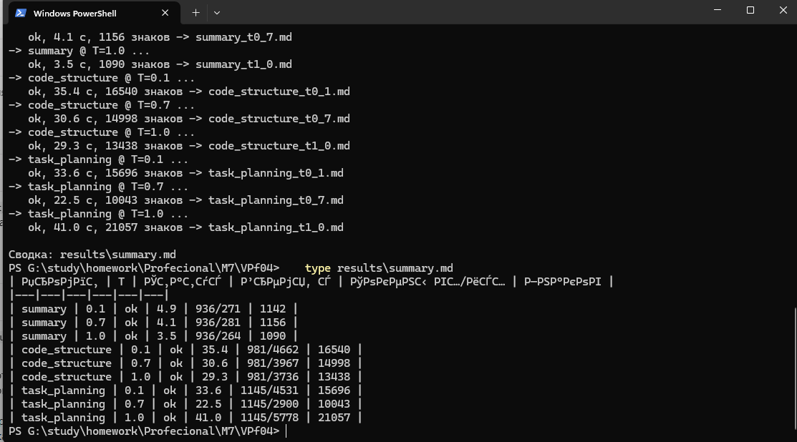
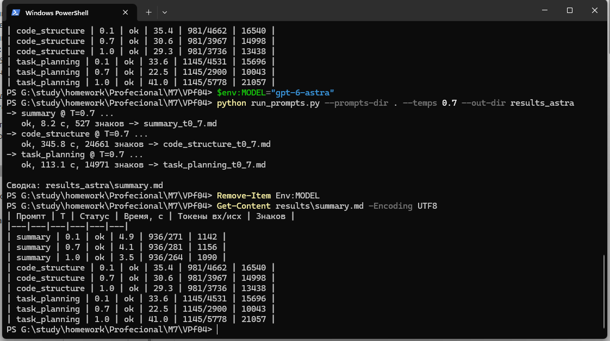

# VPf04 — Кейсы промптов: тестирование трёх промптов

**Курс:** Профессия вайб-кодер · **Модуль:** 7. Внедрение ИИ · **Урок:** VPf04. Кейсы промптов
**Студент:** Евгения Толстых · **Репозиторий:** https://github.com/JaneEva08/VPf04 · **Прогоны:** 24.10.2026

## 1. Задание

Из урока: «Проведи тестирование трёх промптов из урока. Подготовь текстовый отчёт с ключевыми результатами и выводами по каждому промпту». Формат сдачи в уроке: текстовый документ (Яндекс Документы, Google Документы или Word).

Промпты: **Summary** (резюме текста), **Code Structure** (структура кода), **Task Planning** (планирование задач). В уроке температуру меняют у Summary (0.7 / 0.1 / 1.0) и Code Structure (0.7 / 1.0). Я повторила это на всех трёх промптах.

## 2. Что сделано

| № | Требование | Статус | Где |
|---|---|---|---|
| 1 | Протестировать три промпта | ✅ | 12 запросов: [`results/`](results/) (luna, 9 шт.), [`results_astra/`](results_astra/) (astra, 3 шт.); запуск — [`run_prompts.py`](run_prompts.py) |
| 2 | Ключевые результаты по каждому промпту | ✅ | раздел 6 |
| 3 | Выводы по каждому промпту | ✅ | раздел 6 (по каждому) и раздел 7 (общие) |
| 4 | Оформить текстовым документом | ⚠️ | отчёт в Markdown в репозитории; урок просит Яндекс/Google Документы или Word, при необходимости экспортирую |

## 3. Условия запуска

| Параметр | Значение |
|---|---|
| Инструмент | свой скрипт [`run_prompts.py`](run_prompts.py): библиотека `openai`, Chat Completions |
| Провайдер | aiprimetech.io (OpenAI-совместимый API) |
| Основная модель | `gpt-6-luna`, температуры 0.1, 0.7, 1.0, по одному запуску на каждую |
| Дополнительная модель | `gpt-6-astra`, только температура 0.7. Запускала через переменную окружения `MODEL`; в текущей версии скрипта для этого есть флаг `--model` |
| Как собран запрос | system = роль, контекст, структура, формат и примеры из JSON-промпта (`json.dumps`); user = поле `test_input` из того же файла. Остальные параметры по умолчанию, `max_tokens` не задавался |
| Тестовые входы | Summary: текст про ИИ (99 слов); Code Structure: интернет-магазин на FastAPI + React; Task Planning: MVP SaaS для управления задачами, команда 2 frontend + 1 backend + 1 дизайнер, 8 недель |
| Когда | 24.10.2026, luna 13:56–14:00, astra 14:09–14:16 (МСК) |
| Стоимость | ориентировочно ≈ $0,01 (luna) и ≈ $0,6 (astra) за набор по токенам из ответов API и прайсу $0.10/$0.50 и $10/$50 за 1 млн токенов. Списания у провайдера не сверяла |

## 4. Чем отличается от урока и почему

| В уроке | У меня | Почему |
|---|---|---|
| `python .\prompt_chat.py` в Cursor, параметры вводятся в диалоге | свой `run_prompts.py`, параметры в командной строке | нужен прогон всех температур подряд и сохранение каждого ответа в файл; скрипт из урока я не использовала |
| GPT-4o mini (OpenAI) | `gpt-6-luna` через aiprimetech.io, плюс `gpt-6-astra` для сравнения | провайдер из моего стека; luna — дешёвая модель, ближайший аналог GPT-4o mini по роли |
| Как prompt_chat.py собирает запрос из JSON, в уроке не показано | сборка описана в разделе 3 | это моё допущение, оно могло повлиять на формат ответов (раздел 6) |

Неточности в результатах из урока и что показали мои прогоны:

| Что в уроке | Что у меня |
|---|---|
| Раздел «Полученный результат» (по тексту урока): заявлен «микросервисный подход», а описана структура с одним backend и `docker-compose` | во всех четырёх ответах (luna ×3, astra) — «модульный монолит», микросервисы названы более сложной альтернативой |
| Раздел Task Planning: «Разработка бэкенда должна завершиться до начала фронтенда» — два frontend-разработчика простаивали бы | в моих ответах такой зависимости не нашла: у luna контракты API фиксируются в первую неделю и frontend идёт параллельно, у astra интерфейс делается на моках |
| Вывод: «при чётко описанном промпте температура почти не влияет на результат» | для Summary и Code Structure структура сохраняется; у Task Planning на T=1.0 сменился формат ответа (раздел 6) |
| Не проверяется, выполнил ли ответ ограничения самого промпта | проверила: лимит Summary «15–25% от исходного текста» нарушен (раздел 6) |

## 5. Скриншоты



На скриншоте 1 заголовок таблицы нечитаем: это кодировка консоли PowerShell при `type`, сам файл в UTF-8.



## 6. Результаты

### 6.1. Прогоны

`gpt-6-luna`:

| Промпт | T | Время, с | Токены вх / исх | Слов | Формат |
|---|---|---|---|---|---|
| summary | 0.1 | 4.9 | 936 / 271 | 135 | Markdown |
| summary | 0.7 | 4.1 | 936 / 281 | 142 | Markdown |
| summary | 1.0 | 3.5 | 936 / 264 | 133 | Markdown |
| code_structure | 0.1 | 35.4 | 981 / 4662 | 1752 | JSON |
| code_structure | 0.7 | 30.6 | 981 / 3967 | 1433 | JSON |
| code_structure | 1.0 | 29.3 | 981 / 3736 | 1396 | JSON |
| task_planning | 0.1 | 33.6 | 1145 / 4531 | 1900 | Markdown |
| task_planning | 0.7 | 22.5 | 1145 / 2900 | 1242 | Markdown |
| task_planning | 1.0 | 41.0 | 1145 / 5778 | 1878 | **JSON** |

`gpt-6-astra`, T=0.7:

| Промпт | Время, с | Токены вх / исх | Слов | Формат |
|---|---|---|---|---|
| summary | 8.2 | 936 / 170 | 60 | Markdown |
| code_structure | 345.8 | 981 / 6864 | 2364 | Markdown |
| task_planning | 113.1 | 1145 / 4454 | 1849 | Markdown |

Проверка сохранённых ответов ([`check_results.py`](check_results.py), слова считаются без знаков разметки):

```
папка         промпт          T    формат      слов  доля от исходника (Summary)
results       code_structure  0.1  JSON        1752  
results       code_structure  0.7  JSON        1433  
results       code_structure  1.0  JSON        1396  
results       summary         0.1  Markdown     135  136%
results       summary         0.7  Markdown     142  143%
results       summary         1.0  Markdown     133  134%
results       task_planning   0.1  Markdown    1900  
results       task_planning   0.7  Markdown    1242  
results       task_planning   1.0  JSON        1878  
results_astra code_structure  0.7  Markdown    2364  
results_astra summary         0.7  Markdown      60  61%
results_astra task_planning   0.7  Markdown    1849  

Лимит промпта Summary: 15–25% от исходных 99 слов = 15–25 слов.
```

### 6.2. Summary Prompt (резюме текста)

**Результаты.**
- Структура соблюдена всеми четырьмя ответами: заголовок, основная идея, ключевые пункты, важные детали, выводы. Число ключевых пунктов (3–7): luna 5 / 5 / 4, astra 3.
- **Объём не выдержан.** Исходный текст — 99 слов, лимит 15–25 слов. luna выдала 133–142 слова (134–143% исходника), то есть резюме длиннее оригинала. astra — 60 слов (61%): ближе, но всё равно в 2,4–4 раза выше лимита.
- **Факты.** В исходнике «миллиарды долларов». luna на 0.1 и 0.7 пишет только «значительные средства». luna на 1.0 утверждает, что конкретные суммы инвестиций в тексте не приводятся. Это неверно. astra указала «миллиарды долларов» верно.
- Температура: на 0.1, 0.7 и 1.0 набор разделов тот же, меняются заголовок («Развитие ИИ: возможности и вызовы» на 0.1, «Влияние искусственного интеллекта на общество» на 1.0), формулировки и число пунктов.

**Вывод.** Промпт надёжно задаёт структуру, но ограничение по длине модель не соблюдает, и никакой температурой это не лечится. Если лимит важен, его нужно проверять кодом.

### 6.3. Code Structure Prompt (структура кода)

**Результаты.**
- **Формат.** luna вернула валидный JSON на всех трёх температурах: ответ повторяет ключи из промпта (`components`, `format` и др.), а дерево каталогов лежит внутри строк. astra вернула обычный Markdown с нумерованными разделами, как в уроке.
- **Архитектура.** Везде «модульный монолит» (FastAPI + React, PostgreSQL, Alembic, Redis и фоновые задачи в luna и astra).
- **Покрытие требований** из ожидаемого результата: роутеры товаров, заказов, пользователей и платежей; frontend с каталогом, корзиной, заказами и админкой; миграции; сервисы email и платежей; загрузка изображений; структура тестов — есть во всех четырёх ответах (проверено поиском по ключевым словам и просмотром деревьев каталогов). Платежи везде с вебхуками и идемпотентностью.
- **Слабое место.** Аутентификация отдельным middleware не выделена: слово «middleware» встречается только как подключение в `main.py`. JWT вынесен в `security.py` и `dependencies.py`.
- Время: luna 29–35 с, astra 346 с. Объём luna чуть убывает с ростом температуры (1752 → 1433 → 1396 слов), но это по одному прогону.

**Вывод.** Промпт даёт пригодный скелет проекта, который можно сохранить в файл и передать агенту. Формат ответа (JSON или текст) зависит от модели, и его стоит закреплять в промпте явно.

### 6.4. Task Planning Prompt (планирование задач)

**Результаты.**
- Во всех четырёх ответах есть приоритеты Must / Should / Nice, зависимости и критический путь, риски и чекпоинты на концах недель («конец недели N»). luna на 0.7 и astra дополнительно начинают с цели, критериев готовности и допущений. luna на 0.7 даёт 7 этапов и резерв около 20%; оценки по задачам в днях.
- **Параллельная работа.** Зависимость «backend до frontend» из урока я в ответах не встретила: у luna API-контракты фиксируются в первую неделю, и интерфейс идёт параллельно; у astra интерфейс делается на моках, не дожидаясь backend.
- **astra точнее в расчётах.** Явный граф зависимостей T1–T15, таблица загрузки с резервом 25% (backend 192 + 48 = 240 ч из 240 доступных; frontend 188 → 235 ч и 164 → 205 ч из 240) и оценка инфраструктуры в $20–60 в месяц. Арифметику таблицы пересчитала, она сходится.
- **Формат на T=1.0 сменился.** На 0.1 и 0.7 luna вернула Markdown, на 1.0 — JSON. Это единственный случай, когда один и тот же промпт на одной модели дал разный формат при смене температуры.
- Объём luna: 1900 / 1242 / 1878 слов, без монотонной зависимости от температуры.

**Вывод.** Промпт даёт полный и применимый план, а качество расчётов зависит от модели. Для клиентской работы стоит попросить явный формат и проверить арифметику.

## 7. Выводы

Всего 12 запросов (9 на luna, 3 на astra), по одному на комбинацию модели, промпта и температуры. Это наблюдения, а не статистика.

1. **Чёткий промпт держит структуру, но не гарантирует соблюдение своих же ограничений.** Все три промпта дали ожидаемые разделы, но Summary нарушил лимит длины на всех температурах и у обеих моделей (133–142 и 60 слов против 15–25).
2. **Температура меняла формулировки и объём, а в одном случае и формат.** Task Planning на T=1.0 вернул JSON вместо Markdown. Повторится ли это, не проверяла. Гипотеза: влияет моя сборка запроса, в которой JSON-блоки промпта кладутся в system целиком, но подтвердить её нечем.
3. **Смена модели повлияла сильнее температуры.** astra точнее передала факты в Summary, вернула Markdown вместо JSON в Code Structure и дала проверяемые расчёты в Task Planning. Но она дороже (≈ $0,6 против ≈ $0,01 за набор) и заметно медленнее (346 с против 29–35 с на Code Structure). Сравнение только при T=0.7, по одному запуску.
4. **Неточности примера из урока (микросервисы, «backend до frontend») у меня не повторились.** Это результат другой модели и другого запуска, а не доказательство, что промпт стал лучше.
5. **Результат нужно проверять.** Пример из моих прогонов: luna на T=1.0 ошибочно написала, что суммы инвестиций в тексте не названы; в структуре магазина нет отдельного middleware аутентификации. Как черновик такие ответы подходят, как готовое решение — нет.
6. **Для работы по заказам пригодны связки.** План (Task Planning) и скелет проекта (Code Structure) можно получить за минуты и использовать как заготовку для оценки и ТЗ, но проверять их придётся.

## 8. Что поправила по итогам

- Кракозябры в заголовке таблицы при `type results\summary.md` — это кодировка консоли. Для скриншота вывела сводку командой `Get-Content results\summary.md -Encoding UTF8`.
- Черновой `report.md`, который облачная сессия подготовила до моих прогонов по тексту урока, заменён этим отчётом: он описывал результаты из урока, а не мои. Старый файл удалён.
- Имена переменных в скрипте приведены к `.env.example` (`OPENAI_API_KEY`, `OPENAI_BASE_URL`, `AI_MODEL`); старые имена тоже работают. Добавлен флаг `--model`.
- Добавлены тесты вспомогательных скриптов (`pytest`, 8 штук, без обращения к API).

## 9. Что не сделано

- Не запускала `prompt_chat.py` из урока и GPT-4o mini, поэтому прямого сравнения с результатами из урока нет.
- По одному запуску на комбинацию, повторов нет: разброс между запусками одной температуры неизвестен. В частности, не проверила, повторится ли JSON в Task Planning на T=1.0.
- astra прогнана только на T=0.7.
- Не проверяла практически, пригодны ли полученные структура и план: проект по скелету не создавала, оценки часов не сверяла с реальной работой.
- Сами промпты (JSON из урока) в репозиторий не кладу: это материалы платного курса.
- Скриншоты есть только для запуска и сводки; сами ответы лежат в `results/` и `results_astra/`.

## 10. Запуск

```powershell
python -m pip install -r requirements.txt
copy .env.example .env        # впишите OPENAI_API_KEY
# положите рядом три JSON-промпта из урока (в репозитории их нет)
python run_prompts.py --prompts-dir . --dry-run
python run_prompts.py --prompts-dir .                                   # luna, T=0.1 / 0.7 / 1.0
python run_prompts.py --prompts-dir . --model gpt-6-astra --temps 0.7 --out-dir results_astra
python check_results.py results results_astra
python -m pytest -q
```
